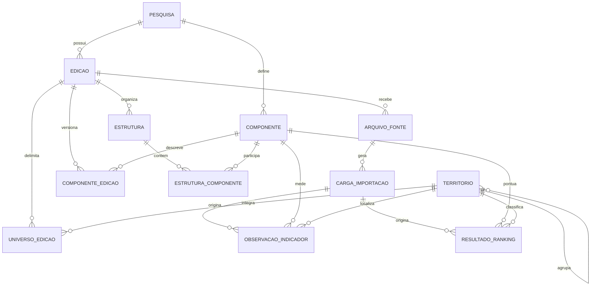

# Modelo relacional

## Decisões principais

- `edicao.ano` é o ano da publicação; `ano_referencia` é o período do dado.
- `componente` representa geral, grupo, pilar, dimensão e indicador nas pesquisas CLP e IBID.
- `componente_edicao` preserva mudanças de nome, fonte, unidade e descrição entre edições.
- `componente_edicao`, `disponibilidade_componente` e `estrutura` também apontam para a carga; revisões da mesma edição permanecem auditáveis.
- `estrutura_componente` é hierárquica e muitos-para-muitos; um indicador poderá pertencer ao ranking padrão, a uma dimensão ESG e a mais de um ODS.
- Municípios usam um identificador técnico estável baseado em nome normalizado + UF; o código oficial permanece em `territorio.codigo_ibge`.
- `universo_edicao.atributos` preserva o perfil municipal variável por carga (capital, população, coordenadas, região e demais campos descritivos).
- `arquivo_fonte` usa SHA-256 e versão. Uma revisão da mesma edição não apaga silenciosamente a carga anterior.
- `-` na planilha vira `NULL`, nunca zero.
- mapas e gráficos não são persistidos: podem ser recalculados a partir de resultados e territórios.
- `territorio` é compartilhado entre pesquisas. A identidade lógica sempre usa `tipo + codigo`, separando, por exemplo, a UF Sergipe (`UF + SE`) da região Sudeste (`REGIAO + SE`).
- No IBID, o arquivo histórico fornece 2014–2024 e os quadros completos fornecem 2025. A sobreposição de 2025 é usada como controle de reconciliação, não como fato duplicado.
